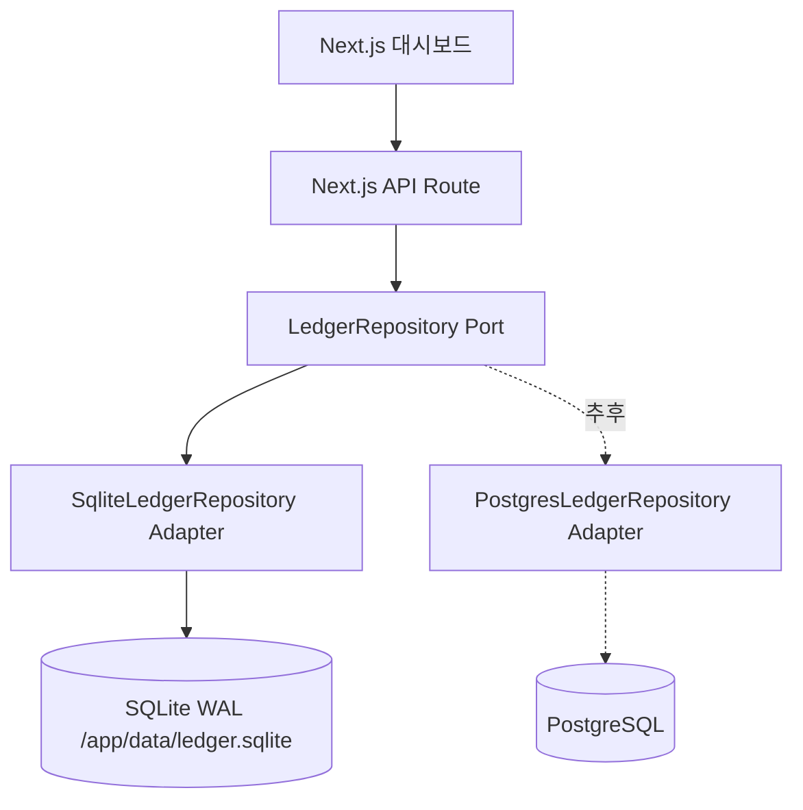
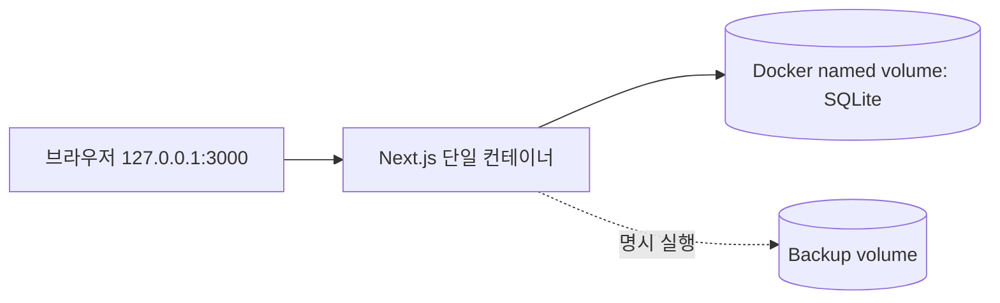

# 아키텍처: SQLite 우선, PostgreSQL 교체 가능

## 1. 논리 구조



거래 원장 항목 생성과 선결제 원가 배분은 `src/domain/postings.ts`, `src/domain/money.ts`에 순수 함수로 둔다. 계좌 조회와 동시성 보장 같은 저장소 경계의 검증은 Adapter에서 구현한다. 향후 PG Adapter에서는 동일한 순수 계산 로직을 재사용해야 한다.

도메인 타입/검증 계층은 `better-sqlite3`, `pg`, `Prisma`, `Kysely` 등을 import하지 않는다. 데이터 저장소 구현체만 DB 벤더에 의존한다.

## 2. Repository Port

`src/domain/ports.ts`에는 `listAccounts`, `createAccount`, `postTransaction`, `listTransactions`, `listReplenishments`, `repayReplenishment`, `getDashboard` 계약만 둔다. 호출자는 port만 의존한다. `src/lib/repository.ts`의 composition root가 `DB_DRIVER=sqlite`를 보고 구체 구현을 주입한다.

향후 PostgreSQL은 **동일 Port를 구현한 새로운 어댑터**를 작성하고, 그 DB 스키마를 마이그레이션하면 된다. SQL 문법, SQLite 트랜잭션 API, ID 변환, 연결 풀은 Adapter 안에만 존재해야 한다. 단순 환경변수 변경만으로 현재 당장 PostgreSQL이 동작하는 것은 아니다.

## 3. 저장소 구조

```text
src/
  app/                        # 화면·API 어댑터(HTTP)
  components/                 # UI
  domain/
    models.ts                 # DTO, 명령 타입
    ports.ts                  # 저장소 Port
    money.ts                  # 순수 계산·검증
    postings.ts               # DB와 무관한 원장 항목 구성
  adapters/
    sqlite/repository.ts      # SQLite Adapter
    postgres/README.md       # PostgreSQL Adapter 구현 지점
  lib/repository.ts           # 생성/주입
sql/001_init.sql              # SQLite 스키마
scripts/migrate.mjs           # 부팅 시 schema version 검증/설치
scripts/backup.mjs            # SQLite 온라인 백업
```

## 4. 배포



- Compose: `app` 단일 서비스. DB 컨테이너는 처음에는 없다.
- 런타임: Node.js, SQLite 파일은 `/app/data/ledger.sqlite`.
- SQLite pragma: `foreign_keys=ON`, `journal_mode=WAL`, `busy_timeout=5000`, `synchronous=FULL` (보수적 내구성 정책).
- DB 컨테이너를 여러 대 띄우거나 SQLite DB 파일을 네트워크 공유로 올리는 구성은 피한다.
- 개발/운영 DB 파일과 백업 파일을 Git에 포함하지 않는다.

## 5. 향후 PostgreSQL 전환 전략

1. 동일 스키마의 PostgreSQL DDL을 별도로 준비한다(타입 변환 포함).
2. `PostgresLedgerRepository implements LedgerRepository`를 구현한다.
3. SQLite와 PostgreSQL 어댑터에 **동일 계약 테스트**를 수행한다.
4. 서비스 중단/쓰기 차단 → 일관된 SQLite 백업 → 데이터 이관 → 잔액/원장 합계/건수 대조.
5. 환경변수 `DB_DRIVER=postgres`로 구체 어댑터를 선택한다. (구현 후)
6. 실패 시 이전 SQLite 백업 및 배포 버전으로 롤백한다.

**이식성 보장 대상**은 도메인 API/데이터 의미이며, SQLite SQL 파일이 PostgreSQL에서 그대로 실행되는 것은 아니다.

## 6. 기술 선택 메모

Next.js + TypeScript, SQLite `better-sqlite3`를 선택한다. 단일 앱이므로 NestJS나 외부 메시지 큐는 초기 도입하지 않는다. 비즈니스 복잡성이 높아지면 `Kysely`의 SQLite/PostgreSQL dialect 사용을 고려할 수 있지만, 현재는 Port/Adapter 분리만으로 충분하다.

공식 참고: [SQLite WAL](https://www.sqlite.org/wal.html), [SQLite network considerations](https://www.sqlite.org/useovernet.html), [Next.js Docker](https://docs.docker.com/guides/nextjs/).
