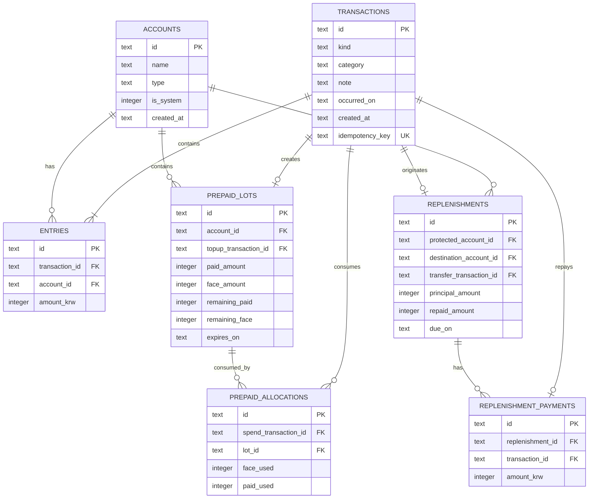

# 데이터베이스 설계 (DATABASE)

- 초기 DB: SQLite 3, WAL, 로컬 파일 `/app/data/ledger.sqlite`
- 향후 DB: PostgreSQL (별도 Adapter/DDL)
- 원화: 정수 단위, 문자열 UUID형 ID. 시스템/사용자 계좌 구분.

## 1. 핵심 ERD



SQL 구현: [`sql/001_init.sql`](../sql/001_init.sql).

## 2. 테이블 설명

| 테이블 | PK | 의미 / 제약 |
|---|---|---|
| `accounts` | UUID TEXT | 은행/현금/저축/충전 계좌, 시스템 계좌 구분. 초기 잔액은 원장에 기록 |
| `transactions` | UUID TEXT | 거래 이벤트 타입, 발생일, 카테고리, 메모, idempotency key |
| `entries` | UUID TEXT | 계좌별 금액 증감. 이벤트 기준 합계 0원 |
| `prepaid_lots` | UUID TEXT | 충전 건별 액면/실결제/잔액/유효기간 |
| `prepaid_allocations` | UUID TEXT | 충전금 소비의 원가/혜택 배분 근거 |
| `replenishments` | UUID TEXT | 보호 계좌에서 임시 인출한 미보충 의무 |
| `replenishment_payments` | UUID TEXT | 어느 이체가 어느 보충 의무를 갚았는지 추적 |

### 확장 예정 테이블

| 테이블 | 향후 역할 |
|---|---|
| `users` | 사용자 인증 및 소유 관계 |
| `account_allocations` | 한 실제 계좌의 가상 목적자금 배분 |
| `budget_cycles`, `budgets` | 급여 주기 / 카테고리 예산 |
| `recurring_rules`, `scheduled_transactions` | 매월 결제 일정 및 발생 상태 |
| `notifications` | 만기, 부족액, 보충 예정 알림 |
| `transaction_reversals` | 취소/정정 거래 연결 |
| `prepaid_expirations`, `prepaid_refunds` | 만료/환불 정산 |

## 3. 조회 및 인덱스

- 계좌 잔액: `SELECT account_id, SUM(amount_krw) FROM entries GROUP BY account_id`.
- 소비 지출: `transactions.kind='expense'` 및 사용자 계좌의 실제 차감액을 기준으로 집계한다. transfer, prepaid_topup, replenishment_repayment는 제외한다.
- 수입: `kind='income'`의 사용자 계좌 증가를 집계한다.
- 할인 혜택: `prepaid_lots.face_amount - prepaid_lots.paid_amount`.
- 보충 미지급: `replenishments.principal_amount - replenishments.repaid_amount`.
- 인덱스: 거래 발생일 역순, entry(account, transaction), lot(account, created_at), replenishment(protected, due_on).

## 4. 원장 검증 쿼리

```sql
-- 불균형 거래가 1건이라도 존재하면 장애로 취급
SELECT t.id, SUM(e.amount_krw) AS imbalance
FROM transactions t
JOIN entries e ON e.transaction_id = t.id
GROUP BY t.id
HAVING SUM(e.amount_krw) <> 0;

-- 사용자 계좌 잔액
SELECT a.name, a.type, COALESCE(SUM(e.amount_krw), 0) AS balance_krw
FROM accounts a
LEFT JOIN entries e ON e.account_id = a.id
WHERE a.is_system = 0
GROUP BY a.id;

-- 미보충금
SELECT id, principal_amount - repaid_amount AS remaining_krw, due_on
FROM replenishments
WHERE principal_amount > repaid_amount;
```

## 5. 주의점

- SQLite `INTEGER`는 64비트이지만 Node Number 안전 정수까지 지원하도록 API 입력 범위를 제한한다.
- 작성일(`created_at`)과 거래 발생일(`occurred_on`)을 혼합해서 급여 주기를 계산하지 않는다.
- SQLite `CHECK`는 **한 거래의 여러 entry 합계가 0원**인지 보장할 수 없다. Adapter의 원자적 저장 및 계약 테스트로 보장한다.
- 다중 사용자 확대 시 `user_id`와 계좌별 접근 권한을 추가하고, 쿼리마다 owner scope를 보장한다.
- 나중에 PostgreSQL로 옮길 때는 SQLite 전용 SQL과 제약 조건을 별도 DDL로 작성해야 한다.
